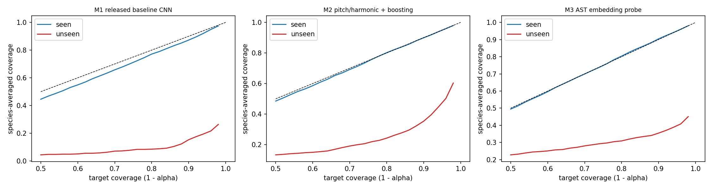

# Phase 1: does standard split-conformal calibration hold on unseen domains?

**Gate verdict:** PREMISE SUPPORTED: standard calibration falls short by more than 5 points on unseen domains in 3 of 3 classifier families (rule: at least 2)

Setup: LAC score (1 - p_true), threshold from the Validation split, target coverage 90%. "seen" and "unseen" test clips follow the official definition (each species has one held-out domain). Species-averaged ("macro") coverage is the gate metric: below 0.85 means the promise falls short by more than 5 points.

## Gate table (alpha = 0.10, marginal LAC, mean over seeds)

| family   |   seen_macro |   unseen_macro |   unseen_macro_sd |   shortfall | premise_holds   | sanity_seen_ok   |
|:---------|-------------:|---------------:|------------------:|------------:|:----------------|:-----------------|
| m1       |        0.876 |          0.165 |             0.019 |       0.735 | True            | True             |
| m2       |        0.900 |          0.362 |             0.009 |       0.538 | True            | True             |
| m3       |        0.904 |          0.355 |             0.000 |       0.545 | True            | True             |

## Ensemble coverage with bootstrap 95% CIs (alpha = 0.10)

| family                       | partition   |   micro |   micro_lo |   micro_hi |   macro |   macro_lo |   macro_hi |   set_size |     n |
|:-----------------------------|:------------|--------:|-----------:|-----------:|--------:|-----------:|-----------:|-----------:|------:|
| M1 released baseline CNN     | seen        |   0.913 |      0.910 |      0.917 |   0.873 |      0.863 |      0.882 |      0.963 | 23015 |
| M1 released baseline CNN     | unseen      |   0.025 |      0.020 |      0.029 |   0.153 |      0.137 |      0.174 |      0.496 |  4202 |
| M2 pitch/harmonic + boosting | seen        |   0.904 |      0.900 |      0.908 |   0.899 |      0.891 |      0.907 |      2.168 | 23015 |
| M2 pitch/harmonic + boosting | unseen      |   0.202 |      0.191 |      0.214 |   0.354 |      0.334 |      0.376 |      2.451 |  4202 |
| M3 AST embedding probe       | seen        |   0.900 |      0.896 |      0.904 |   0.904 |      0.897 |      0.911 |      1.657 | 23015 |
| M3 AST embedding probe       | unseen      |   0.175 |      0.164 |      0.185 |   0.355 |      0.340 |      0.371 |      1.692 |  4202 |

## Seed-averaged results for all targets

| family   | method    |   alpha | partition   |   micro_cov_mean |   micro_cov_std |   macro_cov_mean |   macro_cov_std |   set_size_mean |   set_size_std |   empty_mean |   empty_std |   singleton_mean |   singleton_std |
|:---------|:----------|--------:|:------------|-----------------:|----------------:|-----------------:|----------------:|----------------:|---------------:|-------------:|------------:|-----------------:|----------------:|
| m1       | classcond |   0.050 | seen        |            0.951 |           0.002 |            0.949 |           0.004 |           2.141 |          0.025 |        0.000 |       0.000 |            0.000 |           0.000 |
| m1       | classcond |   0.050 | unseen      |            0.099 |           0.033 |            0.425 |           0.051 |           2.981 |          0.197 |        0.000 |       0.000 |            0.006 |           0.008 |
| m1       | classcond |   0.100 | seen        |            0.902 |           0.002 |            0.899 |           0.002 |           1.004 |          0.016 |        0.031 |       0.008 |            0.934 |           0.004 |
| m1       | classcond |   0.100 | unseen      |            0.051 |           0.015 |            0.226 |           0.028 |           1.434 |          0.148 |        0.044 |       0.033 |            0.486 |           0.095 |
| m1       | classcond |   0.200 | seen        |            0.802 |           0.002 |            0.798 |           0.003 |           0.848 |          0.007 |        0.152 |       0.007 |            0.848 |           0.007 |
| m1       | classcond |   0.200 | unseen      |            0.029 |           0.003 |            0.166 |           0.016 |           0.899 |          0.124 |        0.241 |       0.081 |            0.620 |           0.072 |
| m1       | marginal  |   0.050 | seen        |            0.955 |           0.002 |            0.937 |           0.004 |           1.110 |          0.027 |        0.000 |       0.000 |            0.892 |           0.025 |
| m1       | marginal  |   0.050 | unseen      |            0.052 |           0.016 |            0.227 |           0.028 |           1.475 |          0.108 |        0.002 |       0.003 |            0.546 |           0.093 |
| m1       | marginal  |   0.100 | seen        |            0.913 |           0.004 |            0.876 |           0.005 |           0.988 |          0.013 |        0.018 |       0.006 |            0.977 |           0.003 |
| m1       | marginal  |   0.100 | unseen      |            0.030 |           0.005 |            0.165 |           0.019 |           0.756 |          0.089 |        0.254 |       0.082 |            0.737 |           0.078 |
| m1       | marginal  |   0.200 | seen        |            0.828 |           0.004 |            0.766 |           0.008 |           0.854 |          0.005 |        0.146 |       0.005 |            0.854 |           0.005 |
| m1       | marginal  |   0.200 | unseen      |            0.016 |           0.002 |            0.098 |           0.012 |           0.255 |          0.063 |        0.745 |       0.063 |            0.255 |           0.063 |
| m2       | classcond |   0.050 | seen        |            0.950 |           0.001 |            0.951 |           0.001 |           4.230 |          0.077 |        0.000 |       0.000 |            0.000 |           0.000 |
| m2       | classcond |   0.050 | unseen      |            0.372 |           0.010 |            0.596 |           0.013 |           4.619 |          0.127 |        0.000 |       0.000 |            0.013 |           0.005 |
| m2       | classcond |   0.100 | seen        |            0.901 |           0.001 |            0.902 |           0.002 |           2.366 |          0.051 |        0.000 |       0.000 |            0.191 |           0.008 |
| m2       | classcond |   0.100 | unseen      |            0.241 |           0.006 |            0.407 |           0.012 |           3.068 |          0.060 |        0.000 |       0.000 |            0.079 |           0.024 |
| m2       | classcond |   0.200 | seen        |            0.804 |           0.004 |            0.802 |           0.003 |           1.685 |          0.013 |        0.001 |       0.000 |            0.442 |           0.007 |
| m2       | classcond |   0.200 | unseen      |            0.127 |           0.004 |            0.287 |           0.010 |           1.980 |          0.107 |        0.002 |       0.002 |            0.250 |           0.051 |
| m2       | marginal  |   0.050 | seen        |            0.952 |           0.000 |            0.949 |           0.001 |           2.831 |          0.014 |        0.000 |       0.000 |            0.109 |           0.005 |
| m2       | marginal  |   0.050 | unseen      |            0.338 |           0.006 |            0.472 |           0.004 |           3.567 |          0.037 |        0.000 |       0.000 |            0.100 |           0.004 |
| m2       | marginal  |   0.100 | seen        |            0.904 |           0.001 |            0.900 |           0.002 |           2.200 |          0.018 |        0.000 |       0.000 |            0.238 |           0.007 |
| m2       | marginal  |   0.100 | unseen      |            0.214 |           0.005 |            0.362 |           0.009 |           2.464 |          0.009 |        0.000 |       0.000 |            0.199 |           0.009 |
| m2       | marginal  |   0.200 | seen        |            0.809 |           0.003 |            0.801 |           0.005 |           1.587 |          0.013 |        0.000 |       0.000 |            0.492 |           0.009 |
| m2       | marginal  |   0.200 | unseen      |            0.101 |           0.007 |            0.248 |           0.014 |           1.502 |          0.023 |        0.011 |       0.004 |            0.525 |           0.010 |
| m3       | classcond |   0.050 | seen        |            0.949 |         nan     |            0.949 |         nan     |           3.290 |        nan     |        0.000 |     nan     |            0.000 |         nan     |
| m3       | classcond |   0.050 | unseen      |            0.214 |         nan     |            0.521 |         nan     |           3.328 |        nan     |        0.000 |     nan     |            0.004 |         nan     |
| m3       | classcond |   0.100 | seen        |            0.899 |         nan     |            0.903 |         nan     |           2.038 |        nan     |        0.000 |     nan     |            0.402 |         nan     |
| m3       | classcond |   0.100 | unseen      |            0.169 |         nan     |            0.376 |         nan     |           2.197 |        nan     |        0.000 |     nan     |            0.203 |         nan     |
| m3       | classcond |   0.200 | seen        |            0.804 |         nan     |            0.807 |         nan     |           1.204 |        nan     |        0.002 |     nan     |            0.801 |         nan     |
| m3       | classcond |   0.200 | unseen      |            0.129 |         nan     |            0.279 |         nan     |           1.074 |        nan     |        0.049 |     nan     |            0.830 |         nan     |
| m3       | marginal  |   0.050 | seen        |            0.947 |         nan     |            0.950 |         nan     |           2.162 |        nan     |        0.000 |     nan     |            0.350 |         nan     |
| m3       | marginal  |   0.050 | unseen      |            0.206 |         nan     |            0.398 |         nan     |           2.206 |        nan     |        0.000 |     nan     |            0.347 |         nan     |
| m3       | marginal  |   0.100 | seen        |            0.900 |         nan     |            0.904 |         nan     |           1.657 |        nan     |        0.000 |     nan     |            0.525 |         nan     |
| m3       | marginal  |   0.100 | unseen      |            0.175 |         nan     |            0.355 |         nan     |           1.692 |        nan     |        0.000 |     nan     |            0.516 |         nan     |
| m3       | marginal  |   0.200 | seen        |            0.804 |         nan     |            0.804 |         nan     |           1.188 |        nan     |        0.000 |     nan     |            0.816 |         nan     |
| m3       | marginal  |   0.200 | unseen      |            0.142 |         nan     |            0.309 |         nan     |           1.188 |        nan     |        0.000 |     nan     |            0.816 |         nan     |

## Per-species coverage (ensemble, alpha = 0.10)

| family   | species   | partition   |    n |   coverage |   set_size |   top1_acc |
|:---------|:----------|:------------|-----:|-----------:|-----------:|-----------:|
| m1       | Ae.aeg    | seen        | 7967 |      0.907 |      0.957 |      0.927 |
| m1       | Ae.aeg    | unseen      |  192 |      0.000 |      0.016 |      0.000 |
| m1       | Ae.alb    | seen        | 1433 |      0.851 |      0.935 |      0.884 |
| m1       | Ae.alb    | unseen      |  419 |      0.000 |      0.368 |      0.014 |
| m1       | Cx.qui    | seen        | 6534 |      0.955 |      0.978 |      0.966 |
| m1       | Cx.qui    | unseen      |  672 |      0.000 |      0.173 |      0.000 |
| m1       | An.gam    | seen        | 3882 |      0.884 |      0.959 |      0.903 |
| m1       | An.gam    | unseen      |  818 |      0.000 |      0.319 |      0.000 |
| m1       | An.ara    | seen        |  292 |      0.709 |      0.932 |      0.743 |
| m1       | An.ara    | unseen      | 1820 |      0.000 |      0.736 |      0.000 |
| m1       | An.dir    | unseen      |   40 |      0.000 |      0.325 |      0.000 |
| m1       | Cx.pip    | seen        | 2907 |      0.929 |      0.967 |      0.946 |
| m1       | Cx.pip    | unseen      |   68 |      0.794 |      0.853 |      0.824 |
| m1       | An.min    | unseen      |   99 |      0.222 |      0.929 |      0.263 |
| m1       | An.ste    | unseen      |   74 |      0.365 |      0.649 |      0.500 |
| m2       | Ae.aeg    | seen        | 7967 |      0.866 |      2.278 |      0.483 |
| m2       | Ae.aeg    | unseen      |  192 |      0.073 |      2.500 |      0.010 |
| m2       | Ae.alb    | seen        | 1433 |      0.884 |      2.405 |      0.595 |
| m2       | Ae.alb    | unseen      |  419 |      0.594 |      3.069 |      0.126 |
| m2       | Cx.qui    | seen        | 6534 |      0.948 |      1.773 |      0.859 |
| m2       | Cx.qui    | unseen      |  672 |      0.086 |      2.272 |      0.036 |
| m2       | An.gam    | seen        | 3882 |      0.906 |      2.610 |      0.505 |
| m2       | An.gam    | unseen      |  818 |      0.088 |      2.490 |      0.015 |
| m2       | An.ara    | seen        |  292 |      0.877 |      2.534 |      0.455 |
| m2       | An.ara    | unseen      | 1820 |      0.155 |      2.429 |      0.030 |
| m2       | An.dir    | unseen      |   40 |      0.075 |      1.575 |      0.025 |
| m2       | Cx.pip    | seen        | 2907 |      0.916 |      2.009 |      0.762 |
| m2       | Cx.pip    | unseen      |   68 |      0.897 |      2.029 |      0.750 |
| m2       | An.min    | unseen      |   99 |      0.798 |      1.939 |      0.414 |
| m2       | An.ste    | unseen      |   74 |      0.419 |      2.081 |      0.095 |
| m3       | Ae.aeg    | seen        | 7967 |      0.865 |      1.815 |      0.654 |
| m3       | Ae.aeg    | unseen      |  192 |      0.214 |      1.438 |      0.115 |
| m3       | Ae.alb    | seen        | 1433 |      0.916 |      1.606 |      0.783 |
| m3       | Ae.alb    | unseen      |  419 |      0.857 |      1.592 |      0.702 |
| m3       | Cx.qui    | seen        | 6534 |      0.937 |      1.391 |      0.852 |
| m3       | Cx.qui    | unseen      |  672 |      0.205 |      1.683 |      0.109 |
| m3       | An.gam    | seen        | 3882 |      0.894 |      1.773 |      0.675 |
| m3       | An.gam    | unseen      |  818 |      0.045 |      1.648 |      0.022 |
| m3       | An.ara    | seen        |  292 |      0.901 |      1.829 |      0.647 |
| m3       | An.ara    | unseen      | 1820 |      0.005 |      1.812 |      0.001 |
| m3       | An.dir    | unseen      |   40 |      0.000 |      1.425 |      0.000 |
| m3       | Cx.pip    | seen        | 2907 |      0.912 |      1.674 |      0.764 |
| m3       | Cx.pip    | unseen      |   68 |      0.926 |      1.221 |      0.912 |
| m3       | An.min    | unseen      |   99 |      0.808 |      1.354 |      0.677 |
| m3       | An.ste    | unseen      |   74 |      0.135 |      1.554 |      0.054 |

## Per-domain coverage on unseen clips (ensemble, alpha = 0.10)

| family   | domain   |    n |   coverage |   set_size |
|:---------|:---------|-----:|-----------:|-----------:|
| m1       | D1       | 3310 |      0.000 |      0.519 |
| m1       | D2       |  518 |      0.042 |      0.475 |
| m1       | D3       |  260 |      0.208 |      0.235 |
| m1       | D4       |  114 |      0.237 |      0.535 |
| m2       | D1       | 3310 |      0.125 |      2.412 |
| m2       | D2       |  518 |      0.633 |      2.853 |
| m2       | D3       |  260 |      0.288 |      2.377 |
| m2       | D4       |  114 |      0.298 |      1.904 |
| m3       | D1       | 3310 |      0.056 |      1.745 |
| m3       | D2       |  518 |      0.847 |      1.546 |
| m3       | D3       |  260 |      0.400 |      1.381 |
| m3       | D4       |  114 |      0.088 |      1.509 |

# Phase 1b repair previews (no retraining, ensembles, alpha = 0.10, PREVIEW ONLY)

## R5 temperature scaling before conformal

| family   | calibration   |     T | partition   |   macro_cov |   micro_cov |   set_size |
|:---------|:--------------|------:|:------------|------------:|------------:|-----------:|
| m1       | raw           | 0.820 | seen        |       0.873 |       0.913 |      0.963 |
| m1       | raw           | 0.820 | unseen      |       0.153 |       0.025 |      0.496 |
| m1       | temp-scaled   | 0.820 | seen        |       0.873 |       0.913 |      0.963 |
| m1       | temp-scaled   | 0.820 | unseen      |       0.153 |       0.025 |      0.572 |
| m2       | raw           | 0.880 | seen        |       0.899 |       0.904 |      2.168 |
| m2       | raw           | 0.880 | unseen      |       0.354 |       0.202 |      2.451 |
| m2       | temp-scaled   | 0.880 | seen        |       0.899 |       0.902 |      2.167 |
| m2       | temp-scaled   | 0.880 | unseen      |       0.364 |       0.215 |      2.536 |
| m3       | raw           | 1.800 | seen        |       0.904 |       0.900 |      1.657 |
| m3       | raw           | 1.800 | unseen      |       0.355 |       0.175 |      1.692 |
| m3       | temp-scaled   | 1.800 | seen        |       0.906 |       0.900 |      1.652 |
| m3       | temp-scaled   | 1.800 | unseen      |       0.354 |       0.173 |      1.679 |

## R3 few-shot target calibration (k labelled unseen-domain clips per species)

| family   |   k_per_species |   species_used |   macro_cov |   macro_cov_sd |   micro_cov |   set_size |
|:---------|----------------:|---------------:|------------:|---------------:|------------:|-----------:|
| m1       |               5 |              9 |       0.916 |          0.035 |       0.854 |      8.032 |
| m1       |              10 |              9 |       0.904 |          0.025 |       0.830 |      7.926 |
| m1       |              20 |              9 |       0.901 |          0.023 |       0.824 |      7.920 |
| m1       |              50 |              8 |       0.900 |          0.012 |       0.795 |      7.881 |
| m2       |               5 |              9 |       0.920 |          0.027 |       0.965 |      8.466 |
| m2       |              10 |              9 |       0.893 |          0.030 |       0.929 |      8.100 |
| m2       |              20 |              9 |       0.901 |          0.018 |       0.942 |      8.190 |
| m2       |              50 |              8 |       0.902 |          0.014 |       0.801 |      7.159 |
| m3       |               5 |              9 |       0.914 |          0.033 |       0.826 |      7.937 |
| m3       |              10 |              9 |       0.905 |          0.029 |       0.812 |      7.867 |
| m3       |              20 |              9 |       0.901 |          0.021 |       0.799 |      7.821 |
| m3       |              50 |              8 |       0.899 |          0.019 |       0.781 |      7.803 |

## R2 shift-weighted calibration (heuristic)

| family   | shift_features          |   seen_vs_unseen_AUC |   macro_cov |   micro_cov |   set_size |   eff_sample_size |
|:---------|:------------------------|---------------------:|------------:|------------:|-----------:|------------------:|
| m1       | model log-probabilities |                0.989 |       0.216 |       0.038 |      1.333 |           167.077 |
| m2       | hand-built features     |                0.975 |       0.410 |       0.254 |      2.909 |           339.171 |
| m3       | hand-built features     |                0.993 |       0.331 |       0.156 |      1.390 |            22.138 |

## R6 conformal sets at coarser taxonomy levels

| level             | family   | partition   |   macro_cov |   micro_cov |   set_size |   balanced_acc |
|:------------------|:---------|:------------|------------:|------------:|-----------:|---------------:|
| species (9)       | m1       | seen        |       0.873 |       0.913 |      0.963 |          0.895 |
| species (9)       | m1       | unseen      |       0.153 |       0.025 |      0.496 |          0.178 |
| species (9)       | m2       | seen        |       0.899 |       0.904 |      2.168 |          0.610 |
| species (9)       | m2       | unseen      |       0.354 |       0.202 |      2.451 |          0.167 |
| species (9)       | m3       | seen        |       0.904 |       0.900 |      1.657 |          0.729 |
| species (9)       | m3       | unseen      |       0.355 |       0.175 |      1.692 |          0.288 |
| sibling group (8) | m1       | seen        |       0.893 |       0.902 |      0.925 |          0.940 |
| sibling group (8) | m1       | unseen      |       0.111 |       0.015 |      0.218 |          0.200 |
| sibling group (8) | m2       | seen        |       0.900 |       0.896 |      1.887 |          0.667 |
| sibling group (8) | m2       | unseen      |       0.379 |       0.300 |      2.233 |          0.191 |
| sibling group (8) | m3       | seen        |       0.900 |       0.893 |      1.432 |          0.788 |
| sibling group (8) | m3       | unseen      |       0.381 |       0.173 |      1.547 |          0.323 |
| genus (3)         | m1       | seen        |       0.916 |       0.904 |      0.918 |          0.963 |
| genus (3)         | m1       | unseen      |       0.238 |       0.423 |      0.670 |          0.330 |
| genus (3)         | m2       | seen        |       0.907 |       0.900 |      1.624 |          0.718 |
| genus (3)         | m2       | unseen      |       0.659 |       0.817 |      1.570 |          0.448 |
| genus (3)         | m3       | seen        |       0.906 |       0.899 |      1.220 |          0.833 |
| genus (3)         | m3       | unseen      |       0.567 |       0.597 |      1.249 |          0.487 |

## Caveats

- The Validation split was also used to choose the released M1 checkpoints, so M1 calibration is slightly optimistic.
- Unseen-clip counts per species are small for some species; their coverage estimates are noisy (see n).
- Sets can reach coverage trivially by being large; always read coverage together with set size.
- R2 is a heuristic weighted-quantile; R3 assumes labelled clips from the new domain are available.